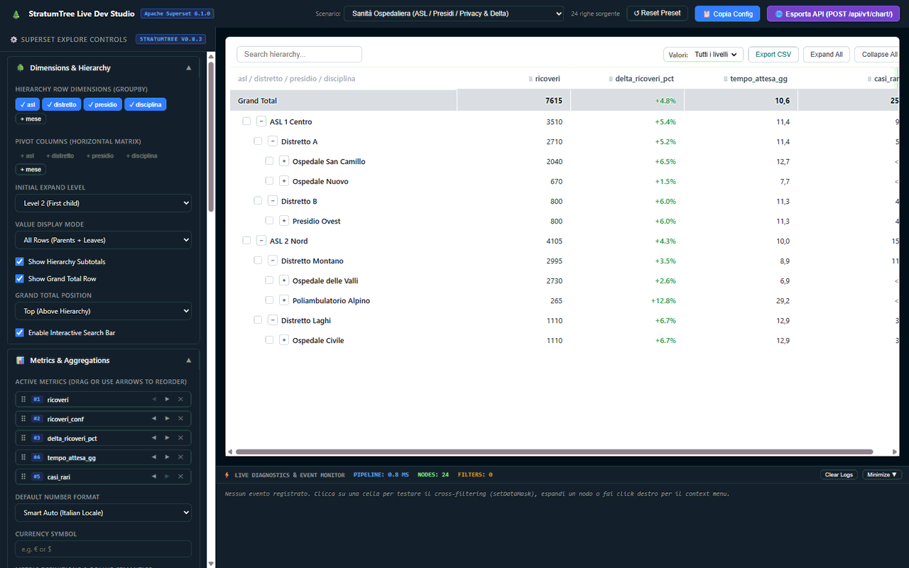
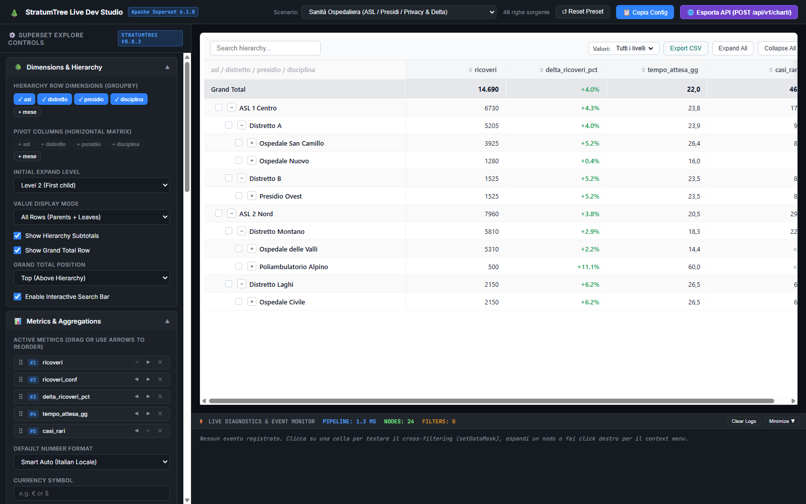
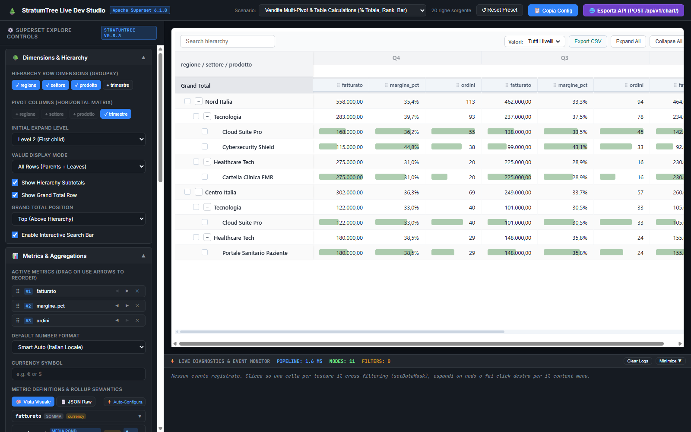
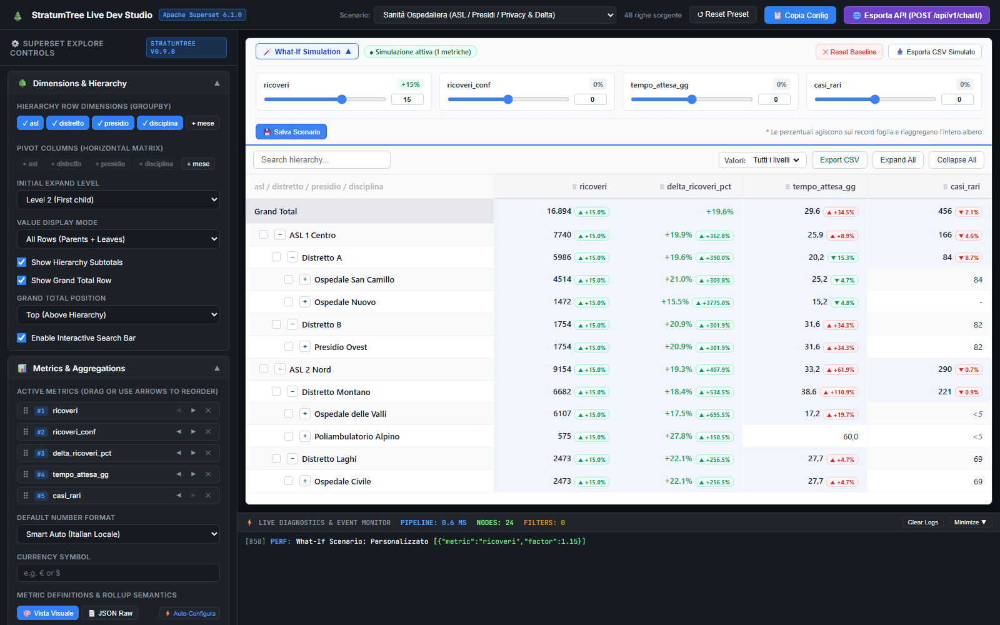
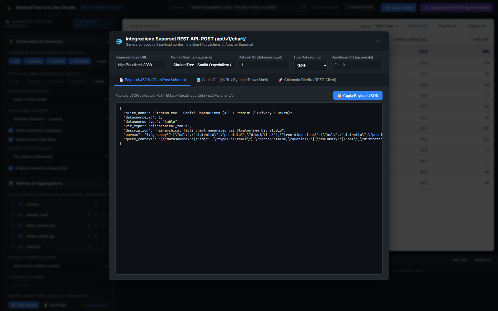

# @superset-plugin-chart/hierarchical-table

Frontend visualization plugin for **Apache Superset 6.1.0+** providing a rich, interactive Tree Table and Matrix Grid Chart Plugin (StratumTree) with multi-level rollup aggregations, parent-child graph resolution, cross-filtering, explicit metric semantics, confidence intervals and small-number suppression for health data.



*Live Dev Studio: Interactive workbench featuring real-time Explore control panel synchronization, dual-mode hierarchy tree, multi-pivot matrix, and sub-50ms Hot Module Reloading.*

## Features

- **Four Macro-Sections Control Panel**: Organized canonically into `Data`, `Customize`, `Comparison & Analysis`, and `Performance & Limits`.
- **Dual-Mode Hierarchy**: Multi-Dimension Level Grouping (e.g. Region, Country, City, Store) and Parent-Child Adjacency (ID / Parent ID / Label).
- **Time Comparison & Variance**: Time grain, reference period (current, previous, ytd), and comparison strategy (prev_period, prev_year_same_period, budget_target) wired end-to-end against pivot periods.
- **Weighted Average Rollup**: Native `weighted_avg` aggregation with explicit `weightColumn` metric selection and fallback to arithmetic mean when weights sum to zero.
- **Prioritized Conditional Formatting**: Cell, row, and column rules with operators (<, <=, ==, >=, >, between, regex) resolved by ascending priority order with static regex safety safeguards.
- **Theme & Palette Profiles**: 5 nominal palette profiles (`standard`, `colorblind`, `stratum-warm`, `stratum-cool`, `custom`) with custom hex overrides and WCAG contrast ratio checks.
- **Goal Benchmarks**: Per-metric target thresholds with attainment calculation, status progression (`achieved`, `on_track`, `at_risk`, `missed`), and directional evaluation (`higher_is_better`, `lower_is_better`).
- **Expression & Metric Sorting**: Sorting by hierarchy name, query metrics, structural properties (`__tree_level__`, `__leaf_count__`), and derived expressions (`delta_*_pct`), paired with configurable `nullHandling` (`bottom`, `top`, `exclude`).
- **Large Tree Virtualization**: Configurable `pageSize` and `virtualizationThreshold` using windowed rendering for high-volume trees with parent-delegated cross-filter interactions.
- **Multi-Selection Cross-Filtering**: Native Superset 6.1.0 `setDataMask` integration with grouped `IN` filters, checkboxes and multi-row highlighting.
- **Automatic Rollups & Grand Total**: Post-order tree aggregation for subtotals (SUM, AVG, MIN, MAX, COUNT, WEIGHTED_AVG), level-aware hybrid MAX/SUM roll-ups for distinct physical unit counters (`Sportelli Attivi`, `Sedi Attive`), automatic averaging for duration/rate metrics (`Tempo Gestione Sportello`), and a Grand Total row.
- **Two-Way Pivot Matrix Grid**: Horizontal row totals and column subtotals (the pivot time delta columns work with a single pivot dimension).
- **Metric Definitions**: Declare per metric `sum`, `mean`, `distinct_count`, `ratio` (parents and totals are a ratio of sums), `delta_pct` or `none`, plus format and polarity, instead of relying on name heuristics.
- **Confidence Intervals and Significance Signal**: Wilson and Poisson intervals on ratios, with a marker only when the whole interval lies above or below the parent, the total or the goal.
- **Small-Number Suppression**: Hides counts below a threshold with complementary suppression, so published tables do not disclose small cells (hidden values never reach sorting, colours or the CSV export).
- **Trend Sparklines and Indicators**: A Trend column per metric over the periods, and icons on conditional formatting rules.
- **Interactive What-If Simulation & Scenario Manager**: Real-time simulation toolbar with sliders (-50% to +50%), leaf-level multiplier recalculation, ratio and subtotal rollup consistency, polarity-aware in-cell delta badges (▲/▼), preset scenario saving in session storage, and enriched CSV export.

## Installation & Setup

Install the plugin dependency:

```bash
npm install superset-plugin-chart-hierarchical-table
```

### Registration in Superset

In `superset-frontend/src/visualizations/presets/MainPreset.ts` (or `MainPreset.js`):

```typescript
import { HierarchicalTableChartPlugin } from 'superset-plugin-chart-hierarchical-table';

new HierarchicalTableChartPlugin().configure({ key: 'hierarchical_table' }).register();
```

### Local Automated Installation

To register and synchronize the plugin directly into a local Apache Superset development environment, run:

```bat
install.bat
```

or use the PowerShell installer:

```powershell
powershell -ExecutionPolicy Bypass -File install-plugin.ps1
```

## Build & Validation

To build declarations and the ESM bundle:

```bash
npm run build
```

The build compiles TypeScript declarations and bundles `dist/index.esm.js` via esbuild.

To run typechecking:

```bash
npx tsc --noEmit
```

To run the complete Jest test suite:

```bash
npm test
```

## Live Dev Studio (Superset Explore Workbench)

A dedicated interactive development workbench is included in `dev-studio/` for rapid prototyping, visual verification, and interactive control testing without needing a running Superset backend.

### Launching the Dev Studio

Start the local development server:

```bash
npm run dev
```

Or on Windows, double-click:

```cmd
dev.bat
```

The workbench opens at `http://localhost:5173/` with sub-50ms Hot Module Reloading (HMR).

### Dev Studio Workbench Showcase

#### 1. Healthcare & Hospital Operations (Suppression & Variance)



Multi-level regional healthcare hierarchy (Regione, ASL, Ospedale, Reparto) with admissions, bed occupancy rates, reference period variance (`delta_*_pct`), and small-number privacy suppression (`<5` patient privacy threshold). Explore panel controls on the left allow real-time parameter tweaking with immediate visual feedback.

#### 2. Sales Multi-Pivot Matrix (In-Cell Data Bars & Heatmap)



Multi-dimensional pivot matrix by Quarter and Sales Channel. Demonstrates interactive rollup semantics, in-cell bipolar data bars, currency and percentage number formatters, automatic subtotals, and column grand totals.

#### 3. High-Volume Virtualization Stress Test (5,000 Rows)


Windowed rendering benchmark demonstrating smooth 60fps scrolling and sub-second calculation pipeline across 5,000 deep hierarchical tree rows with live memory tracking.

#### 4. Interactive What-If Simulation & Scenario Manager



Real-time calculation engine applying multiplicative percentage variations strictly to leaf records while maintaining mathematical rollup integrity across parent subtotals, weighted averages, and ratio metrics. Directional delta badges with polarity sensitivity highlight simulated gains and losses directly in-cell, accompanied by preset saving and enriched CSV export.

#### 5. Superset REST API Automation Modal (`POST /api/v1/chart/`)



Direct chart provisioning dialog conforming to the official Apache Superset REST API specification. Features `ChartPostSchema` validation, copyable cURL, Python and PowerShell code snippets with JWT authentication and CSRF protection, plus one-click in-browser chart creation.

### Dev Studio Features

- **Split-Screen Layout**: Left panel houses the full Superset Explore control panel (5 collapsible accordion sections); right panel displays the live chart rendering; bottom drawer monitors runtime events.
- **Interactive Explore Controls**: Toggle hierarchy modes, change rollup aggregations, switch display modes (Values, Delta, Both), configure Table Calculations, enable Diverging Heatmaps and Bipolar Data Bars, adjust privacy suppression thresholds, and tweak virtualization settings with instant re-render.
- **Built-in Benchmark Scenarios**:
  - *Healthcare & Sanita*: Multi-level regional hierarchy (Regione, ASL, Ospedale, Reparto), admissions, bed occupancy rate, deltas, and privacy suppression (<5).
  - *Sales Multi-Pivot*: Multi-dimension pivots (Quarter, Channel), table calculations (% of Column Total, Running Total), and bipolar bars for profit margin.
  - *High-Volume Stress Test*: 5,000-row tree generator validating 60fps virtualization and windowing performance.
- **Diagnostics & Event Drawer**: Real-time monitor logging Superset `setDataMask` cross-filter emissions, Context Menu drill events, and transform pipeline calculation latency in milliseconds.
- **Preset Management & Export**: Switch presets or export active `formData` as clean JSON for direct paste into Superset dashboards or automated tests.
- **Superset REST API Integration (`POST /api/v1/chart/`)**: Direct generation of `ChartPostSchema` payloads conforming to official documentation, with copyable cURL, Python and PowerShell scripts, as well as in-browser direct API dispatch.

## Superset REST API Integration (`POST /api/v1/chart/`)

In compliance with the official [Superset Create Chart API](https://superset.apache.org/developer-docs/api/create-a-new-chart/), the plugin provides tools to programmatically create and register charts directly onto any Apache Superset instance.

### CLI Automation Script

Use [`scripts/create_chart_api.py`](scripts/create_chart_api.py) to create charts from the command line:

```bash
# Test the payload generation without sending network requests
python scripts/create_chart_api.py --dry-run --preset healthcare

# Create chart on a live Apache Superset instance
python scripts/create_chart_api.py \
  --url http://localhost:8088 \
  --username admin \
  --password admin \
  --dataset-id 1 \
  --chart-name "Monitoraggio Strutture Sanitarie" \
  --preset healthcare
```

### Dev Studio API Modal

Within the Dev Studio (`http://localhost:5173/`), click **🌐 Esporta API (POST /api/v1/chart/)** in the top navigation bar to:

1. Preview the exact `ChartPostSchema` JSON structure containing serialized `params` and `query_context`.
2. Copy ready-to-run cURL (Bash), Python (requests), or PowerShell scripts with automated JWT login and CSRF handling.
3. Execute a live REST request directly from the browser to create the chart and obtain a direct link to Superset Explore (`/explore/?slice_id=...`).
