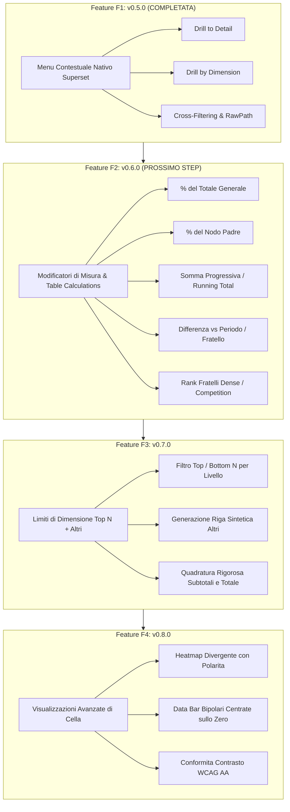

# StratumTree: Piano di Implementazione Feature Competitor (F1-F4)

> **Skill invocate**: /plan-master, /deepwork, /teamwork-preview
> **Plugin target**: superset-plugin-chart-hierarchical-table (StratumTree)
> **Branch**: main
> **Autore**: Francesco Castaldi <francesco.castaldi@mapsgroup.it>
> **Data inizio**: 15 Ottobre 2026
> **Baseline di partenza**: v0.4.1 (commit 1a37d1c) -> v0.5.0 completata (commit fe21418)

---

## 🎯 1. Visione d'Insieme & Benchmark Competitor

StratumTree (hierarchical_table) e il plugin gerarchico avanzato per Apache Superset sviluppato per contesti sanitari ed enterprise complessi.
Questo piano introduce quattro macro-funzionalita ispirate alle migliori piattaforme di Business Intelligence concorrenti (Qlik Sense, Tableau, Power BI), portando la visualizzazione pivot e gerarchica a un livello di parita funzionale e analitica superiore.



---

## 👥 2. Teamwork Preview: Ruoli & Modalita Operativa

In conformita con il framework Deepwork e Teamwork, lo sviluppo viene orchestrato secondo una chiara separazione delle responsabilita:

| Ruolo | Specializzazione & Ambito | Output & Invarianti |
|:---|:---|:---|
| **Architetto & Supervisor (Orchestrator)** | Governance dei requisiti, rispetto dei vincoli architetturali, non-regressione dei controlli esistenti. | `docs/IMPLEMENTATION_PLAN_COMPETITOR_FEATURES.md`, gestione SemVer, aggiornamento `CHANGELOG.md`. |
| **Engine Specialist (Pure Logic)** | Sviluppo moduli matematici e algoritmici puri in `src/utils/` (zero dipendenze React/DOM). | Moduli puri: `tableCalculations.ts`, `dimensionLimits.ts`, `divergingHeatmap.ts`. 100% TDD con test rossi preventivi. |
| **UI & ControlPanel Integrator** | Tipizzazione `HierarchicalTableFormData`, controlli Superset Explore, destructuring difensivo in `formDataOptions.ts`, rendering in `HierarchicalTable.tsx`. | Esposizione controlli in Explore, layout bloccato con test di snapshot, estensione CSS pulita. |
| **QA & Verification Gate** | Esecuzione rigorosa test nel mirror locale `%LOCALAPPDATA%` tramite `run-mirror-tests.ps1`, benchmark prestazionale e verifica build ESM. | 100% test verdi (Jest), `tsc --noEmit` a zero errori, bundle `dist/index.esm.js` compatto, parita dual-remote. |

---

## 🗺️ 3. Roadmap Sequenziale delle Release

Tutte le feature vengono rilasciate in modo incrementale e sequenziale (mai in parallelo, poiche condividono la catena di trasformazione `transformProps` e `HierarchicalTable.tsx`):

| Release | Versione | Ambito | Ispirazione Competitor | Stato |
|:---|:---|:---|:---|:---|
| **F1** | `v0.5.0` | Menu contestuale Superset (Drill to detail, Drill by, Cross-filter, `TreeNode.rawPath`) | Tableau Action Filters / Power BI Drillthrough | **Completata (15/10/2026)** |
| **F2** | `v0.6.0` | Modificatori di misura e calcoli tabellari (% del totale, % del padre, running total, rank) | Qlik Sense Master Measures / Tableau Quick Table Calcs | **In Pianificazione (Ready)** |
| **F3** | `v0.7.0` | Limiti di dimensione per livello (Top N + riga sintetica "Altri" con quadratura totali) | Qlik Sense Dimension Limits / MicroStrategy Top N | Da eseguire dopo F2 |
| **F4** | `v0.8.0` | Heatmap divergente bipolare con polarita e data bar centrate sullo zero | Power BI Conditional Formatting / Excel Data Bars | Da eseguire dopo F3 |

---

## 🔍 4. Specifica Dettagliata: Feature F2 (v0.6.0)

### 4.1 Obiettivo di Business & Analitico
Consentire all'utente di arricchire le metriche tabellari con trasformazioni post-aggregazione calcolate al volo sul grafo dell'albero gerarchico o lungo le colonne pivot, evitando scritture di viste SQL complesse con window function `OVER (PARTITION BY ...)` sul database di produzione.

### 4.2 Tipi di Modificatore Supportati
1. **`pct_of_total` (% del Totale Generale)**:
   - Formula: `(valore_nodo / totale_generale_metrica) * 100`.
   - Si applica sia alle righe foglia che ai nodi padre e totali parziali.
2. **`pct_of_parent` (% del Nodo Padre)**:
   - Formula: `(valore_nodo / valore_padre_diretto) * 100`.
   - Per i nodi radice (livello 0), il padre coincide con il Totale Generale. Sulla riga Totale Generale mostra 100%.
3. **`running_total` (Somma Progressiva / Cumulativa)**:
   - Modalita pivot temporale: accumula la somma della metrica da sinistra a destra lungo i periodi pivot ordinati cronologicamente (`period[0] + ... + period[k]`).
   - Modalita fratelli: accumula la somma dei nodi fratelli dall'alto verso il basso nello stesso ramo.
4. **`diff_from_previous` (Differenza dal Periodo o Fratello Precedente)**:
   - Delta assoluto e delta percentuale `(attuale - precedente) / precedente * 100`.
   - Il primo elemento ha cella vuota (`null`).
5. **`rank` (Classifica tra Fratelli)**:
   - Calcola la posizione ordinale (1..N) tra i nodi fratelli dello stesso livello e genitore in base al valore della metrica.
   - Opzioni: `competition` (1, 2, 2, 4) o `dense` (1, 2, 2, 3). Ordinabile.

### 4.3 Modalita di Esposizione: `metricDefinitions` & Nuove Colonne
Per garantire la massima flessibilita:
- L'utente puo definire un modificatore all'interno di `metricDefinitions` (ad esempio `{ "metric": "volume", "modifier": "pct_of_parent" }`), oppure configurare una colonna calcolata aggiuntiva.
- Opzione `modifierDisplay`: `'replace'` (sostituisce il valore originario) oppure `'companion_column'` (aggiunge una colonna affiancata denominata `% Volume (vs Padre)` o `Volume (Cumulativo)`).
- Formattazione automatica: le percentuali ereditano il formato percentuale (`,.1%` o `,.2%`), il rank riceve formato intero.

### 4.4 Modulo Puro: `src/utils/tableCalculations.ts`
Funzioni pure TDD senza dipendenze DOM:
- `applyTableCalculations(tree: TreeNode[], grandTotal: TreeNode | null, options: TableCalculationOptions): TreeNode[]`
- `computePercentOfTotal(nodeValue: number | null, totalValue: number | null): number | null`
- `computePercentOfParent(nodeValue: number | null, parentValue: number | null): number | null`
- `computeRunningTotalOnPeriods(rowValues: Record<string, number | null>, periodKeys: string[]): Record<string, number | null>`
- `computeSiblingRank(siblings: TreeNode[], metricKey: string, method: 'competition' | 'dense'): Map<string, number>`

### 4.5 Task Breakdown Atomico F2 (TDD)
- **Task 2.1 (Tipi)**: Aggiunta tipi `TableCalculationType`, `TableCalculationConfig` a `src/types/index.ts`. Estensione di `HierarchicalTableFormData`.
- **Task 2.2 (Engine TDD Rosso)**: Creazione suite `test/tableCalculations.test.ts` con 12 scenari di test (gerarchia a 3 livelli, nodi nulli, denominatore zero, pivot multi-periodo, quadratura percentuali, rank fratelli).
- **Task 2.3 (Engine Green)**: Implementazione di `src/utils/tableCalculations.ts` fino al 100% PASS della suite.
- **Task 2.4 (ControlPanel & Options)**: Aggiornamento `src/plugin/formDataOptions.ts` e aggiunta controlli in `src/plugin/controlPanel.tsx` nella sezione `Comparison & Analysis`.
- **Task 2.5 (Pipeline Wiring)**: Connessione in `src/plugin/transformProps.ts` e `src/plugin/columnBuilders.ts` per generare le colonne o applicare i modificatori.
- **Task 2.6 (Snapshot & Regression)**: Aggiornamento snapshot in `test/controlPanelLayout.test.ts` e verifica 100% suite esistenti verdi.
- **Task 2.7 (Release v0.6.0)**: Bump a 0.6.0 in `package.json`, aggiornamento `CHANGELOG.md`, build ESM `npm run build`, commit e tag.

---

## 🔍 5. Specifica Dettagliata: Feature F3 (v0.7.0)

### 5.1 Obiettivo di Business & Analitico
In tabelle sanitarie ed aziendali con un'alta cardinalita di elementi (es. 200 centri di costo, 500 tipi di visita, 100 comuni), l'esplorazione diventa dispersiva.
Ispirandosi a Qlik Sense ("Limiti di dimensione: Primi 5 / Primi 10 con raggruppamento Altri"), la feature F3 permette di limitare la vista ai principali contributori, mantenendo la certezza matematica del totale.

### 5.2 Funzionalita Chiave
1. **Regole di Limite per Livello**:
   - `dimensionLimits`: configurabile per livello (es. Livello 0 tutti, Livello 1 Top 5 per `Volume`, Livello 2 Top 10 per `Attesa`).
2. **Generazione Automatica Riga Virtuale "Altri" (`Others`)**:
   - I nodi oltre la soglia N vengono raggruppati in un unico nodo virtuale etichettato `Altri (K elementi)` o label personalizzabile.
   - Le metriche additive del nodo `Altri` sono calcolate come somma esatta dei nodi raggruppati.
   - Le metriche di tasso o media pesata vengono calcolate coerentemente tramite pesi aggregati.
3. **Invariante di Quadratura**:
   - Il subtotale del padre e il Totale Generale NON cambiano: coincidono al centesimo con il totale dell'intero dataset.
4. **Comportamento Interattivo**:
   - Il nodo `Altri` mostra un'icona distintiva e un tooltip con il conteggio dei rami inclusi.
   - Nel menu contestuale di F1, il click su `Altri` disabilita opportunamente il drill su ID singolo o genera un filtro con clausola `NOT IN (...)`.

### 5.3 Modulo Puro: `src/utils/dimensionLimits.ts`
- `applyDimensionLimits(nodes: TreeNode[], config: DimensionLimitConfig[], metricSemantics: Map<string, MetricSemantics>): TreeNode[]`
- Gestione ordinamento discendente per metrica target prima del troncamento.
- Creazione nodo `othersNode` con `id = "__others__" + parent.id`, flag `isOthers: true`.

### 5.4 Task Breakdown Atomico F3 (TDD)
- **Task 3.1 (Tipi)**: Definizione `DimensionLimitRule`, `DimensionLimitMode` in `src/types/index.ts`.
- **Task 3.2 (Engine TDD Rosso)**: Scrittura `test/dimensionLimits.test.ts` con 8 casi limite (top N inferiore al totale figli, parita di valore/ties, rami con soli elementi esclusi, preservazione quadratura subtotali).
- **Task 3.3 (Engine Green)**: Implementazione in `src/utils/dimensionLimits.ts`.
- **Task 3.4 (ControlPanel & Wiring)**: Controlli Explore in `Performance & Limits` e integrazione in `src/plugin/treeData.ts`.
- **Task 3.5 (Interazione & Menu Context)**: Protezione del nodo virtuale in `src/plugin/contextMenu.ts`.
- **Task 3.6 (Release v0.7.0)**: Bump SemVer `0.7.0`, CHANGELOG, rebuild bundle, test su mirror.

---

## 🔍 6. Specifica Dettagliata: Feature F4 (v0.8.0)

### 6.1 Obiettivo di Business & Analitico
Portare la resa visiva delle celle al livello di Power BI e Tableau, introducendo scale di colore continue divergenti (3-stop: Min, Centro, Max) che rispettano rigorosamente la polarita semantica della metrica, affiancate da barre dati grafiche bidirezionali con asse zero.

### 6.2 Funzionalita Chiave
1. **Heatmap Divergente a 3 Punti con Polarita**:
   - Palette a 3 colori configurabile (es. Rosso - Giallo - Verde oppure Blu - Bianco - Rosso per accessibilita daltonici).
   - Punto medio (Midpoint): configurabile come valore `0`, `Media del livello`, o valore `Goal/Target`.
   - Polarita: se `lower_is_better` (es. giorni di attesa, tasso di infezione), i valori piu bassi assumono il colore positivo (Verde/Blu) e quelli piu alti il colore di allarme (Rosso/Arancio).
2. **Data Bar Bipolari (Zero-Centered Data Bars)**:
   - Per metriche relative o di scostamento (es. `delta_pct`, differenze di budget): la barra non parte dal bordo sinistro della cella ma da una linea mediana verticale corrispondente allo zero.
   - I valori positivi si estendono verso destra in verde, i valori negativi verso sinistra in rosso.
3. **Accessibilita & Contrasto WCAG AA**:
   - Calcolo automatico della luminanza relativa per garantire un contrasto minimo 4.5:1 del testo nero o bianco sul colore di sfondo generato.

### 6.3 Modulo Puro: `src/utils/advancedCellVisuals.ts`
- `interpolateDivergingColor(value: number, min: number, mid: number, max: number, palette: DivergingPalette, polarity: Polarity): string`
- `computeBipolarDataBar(value: number, minNegative: number, maxPositive: number): { leftPct: number, widthPct: number, color: string }`
- Integrazione armoniosa con gli indicatori SVG introdotti in v0.4.0.

### 6.4 Task Breakdown Atomico F4 (TDD)
- **Task 4.1 (Tipi & CSS)**: Nuovi tipi in `src/types/index.ts`, classi CSS per bar container in `HierarchicalTable.css`.
- **Task 4.2 (Engine TDD Rosso)**: Suite `test/advancedCellVisuals.test.ts` con test su scale continue, interpolazione RGB, inversione di polarita e contrast ratio WCAG.
- **Task 4.3 (Engine Green)**: Implementazione in `src/utils/advancedCellVisuals.ts`.
- **Task 4.4 (ControlPanel & Wiring)**: Nuova sotto-sezione in `Formatting & Aesthetics` e wiring in `src/plugin/columnBuilders.ts` e `HierarchicalTableRow.tsx`.
- **Task 4.5 (Evidence & Snapshot)**: Verifica rendering, assenza regressioni snapshot, esecuzione `run-mirror-tests.ps1`.
- **Task 4.6 (Release v0.8.0)**: Bump SemVer `0.8.0`, CHANGELOG, rebuild bundle, allineamento sito web.

---

## 🛡️ 7. Matrice dei Rischi & Mitigazioni

| Rischio Identificato | Probabilita | Impatto | Strategia di Mitigazione |
|:---|:---:|:---:|:---|
| Collisione tra modificatori di misura e roll-up nativo dei padri | Media | Alto | I modificatori di misura operano rigorosamente post-rollup su una copia clonata del nodo (`node.metrics`), proteggendo la semantica originale dei dati aggregati. |
| Disallineamento del Grand Total con Limiti di Dimensione Top N | Media | Critico | Il nodo sintetico `Altri` viene iniettato a livello di fratelli; il calcolo del genitore usa l'accumulo di tutti i record originari o la somma diretta con `Altri`. Unit test di quadratura matematica con delta < 0.0001. |
| Calo prestazionale nel calcolo running total su alberi profondi | Bassa | Medio | Algoritmi lineari O(N) a passaggio singolo con memoizzazione dei periodi pivot in `Map`. |
| Contrasto testo illeggibile su heatmap divergente con colori scuri | Bassa | Medio | Algoritmo deterministico WCAG per alternare testo `#ffffff` e `#212529` in base alla luminanza percepita dello sfondo. |

---

## 🧪 8. Evidence Gate & Protocollo di Accettazione

Per ciascuna release (F2 v0.6.0, F3 v0.7.0, F4 v0.8.0):
1. **Verifica Mirror Obbligatoria**:
   ```powershell
   powershell -File "03_Sviluppo_Software\Tool_e_Config\scripts\superset-plugin-tests\run-mirror-tests.ps1" -TypeCheck
   ```
   Tutte le suite devono terminare con 100% PASS, zero warning bloccanti e `tsc --noEmit` a zero errori.
2. **Build ESM Verificata**:
   ```powershell
   npm run build
   ```
   Generazione di `dist/index.esm.js` senza errori di bundle.
3. **Commit & Identita**:
   Tutti i commit eseguiti a nome Francesco Castaldi (`francesco.castaldi@mapsgroup.it`), messaggio Conventional Commits (`feat(hierarchical-table): ...`), nessun trattino AI lungo o doppio.
4. **Sincronizzazione Sito & Release**:
   Incremento SemVer in `package.json`, sincronizzazione badge in `site/index.html`, aggiornamento `CHANGELOG.md` sotto Keep a Changelog 1.1.0. Push dual-remote e invio del relativo tag git annotato.
