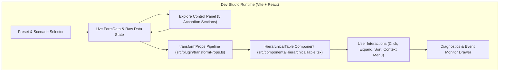

# StratumTree Live Dev Studio & Superset Explore Workbench Implementation Plan

## 🎯 1. Obiettivo & Architettura

L'obiettivo è realizzare un ambiente di sviluppo e collaudo interattivo in tempo reale (**Live Dev Studio & Superset Explore Workbench**) per il plugin `superset-plugin-chart-hierarchical-table` (StratumTree), collocato in una sottocartella dedicata `dev-studio/` e basato su Vite + React con Hot Module Replacement (HMR < 50ms).

L'interfaccia split-screen fornirà la replica fedele dell'esperienza utente di Apache Superset Explore:
1. **Pannello di Sinistra (Explore Control Panel)**: replica interattiva ad accordion delle 5 macro-sezioni di configurazione (`Dimensions & Hierarchy`, `Metrics & Aggregations`, `Comparison & Analysis`, `Display & Formatting`, `Performance & Privacy`), con controlli visivi (toggle switch, dropdown, color pickers, slider, JSON editor assistiti) sincronizzati bidirezionalmente con `formData`.
2. **Area Centrale/Destra (Live Chart Viewport)**: rendering reattivo di `HierarchicalTable` alimentato direttamente da `transformProps.ts`, con aggiornamento in tempo reale ad ogni variazione dei parametri.
3. **Cassetto Inferiore (Live Diagnostics & Event Monitor)**: monitoraggio in tempo reale degli eventi di cross-filtering (`setDataMask`), drill-down e context menu (`drillBy`, `drillToDetail`), tempo di esecuzione di `transformProps` in millisecondi, conteggio nodi renderizzati e ispezione dei payload.
4. **Preset Selector & Data Switcher**: selettore rapido nella barra superiore per passare all'istante tra 3 scenari reali (Sanità Ospedaliera con privacy e delta, Vendite Multi-Canale & Pivot con table calculations, Stress-Test 5.000 righe per virtualizzazione a 60fps) e caricamento di dati personalizzati (JSON/CSV).



---

## 🛡️ 2. Pre-Flight Check, Workspace & Compliance Gate

- [x] Lettura preventiva manifest `D:/Actual/AGENTS.md` e `superset-plugins/AGENTS.md`
- [x] Rilevamento workspace: `D:/Actual/03_Sviluppo_Software/Repositories/superset-plugins/superset-plugin-chart-hierarchical-table/`
- [x] Nessun segreto o credenziale richiesta (ambiente 100% locale, client-side e privo di dipendenze cloud)
- [x] Zero trattini AI em-dash (`—`, `--`, `–`) in codice, commenti e documentazione
- [x] Codifica rigorosa UTF-8 senza BOM
- [x] Identità commit: Francesco Castaldi (`info@francescocastaldi.it`) con firma `git commit -s`
- [x] Installer e script di build conformi agli standard di fallback per Windows

---

## ⚠️ 3. Matrice di Rischio & Breaking Changes

| Rischio Identificato | Probabilità | Impatto | Mitigazione Adottata |
| :--- | :--- | :--- | :--- |
| Conflitto di dipendenze tra Vite e Superset Core | Bassa | Medio | Configurare `dev-studio/` con un proprio `package.json` leggero o alias di risoluzione in `vite.config.ts` che punta direttamente ai file sorgenti `../src/index.ts` e ai mock essenziali di Superset (`@superset-ui/core`). |
| Conflitto di porta locale su porta 5173 | Media | Basso | Configurare Vite con `server: { port: 5173, strictPort: false }` per scalare automaticamente alla porta successiva libera in caso di occupazione. |
| Performance con 5.000+ righe nello scenario stress test | Media | Basso | Sfruttare l'engine di virtualizzazione nativo del plugin (`useFlatTreeVirtualization.ts`) con misurazione attiva del framerate e memoria heap. |

---

## 📋 4. Task Breakdown Atomico (Ciclo TDD)

### Task 1: Scaffolding Ambiente Dev Studio (Vite + TypeScript + Tailwind/CSS)
- **File target**: `dev-studio/package.json`, `dev-studio/vite.config.ts`, `dev-studio/index.html`, `dev-studio/src/main.tsx`
- **Step 1 (Test)**: Creare `test/devStudioConfig.test.ts` verificando l'integrità dei percorsi di risoluzione alias per `src/` e la presenza degli script `npm run dev` e `dev.bat`.
- **Step 2 (Verifica Fallimento)**: `npm test -- test/devStudioConfig.test.ts` -> FAIL (file mancanti).
- **Step 3 (Codice Minimo)**: Configurare `dev-studio/vite.config.ts` con alias verso `../src`, `../package.json` e script batch `dev.bat` nella root del plugin. Aggiungere lo script `"dev": "vite dev-studio"` nel `package.json` principale.
- **Step 4 (Verifica Successo)**: `npm test -- test/devStudioConfig.test.ts` -> PASS.
- **Step 5 (Commit)**: `git commit -s -m "feat(dev-studio): scaffold standalone Vite studio environment"`

### Task 2: Dataset Mock & Scenari Preconfigurati (Sanità, Vendite, Stress 5k)
- **File target**: `dev-studio/src/mockData/healthcareScenario.ts`, `dev-studio/src/mockData/salesPivotScenario.ts`, `dev-studio/src/mockData/stressTestScenario.ts`, `dev-studio/src/mockData/index.ts`
- **Step 1 (Test)**: Creare `test/mockScenarios.test.ts` verificando che ogni scenario fornisca tuple coerenti con la firma attesa da `transformProps` (`queriesData[0].data`, metriche, dimensioni, pivot).
- **Step 2 (Verifica Fallimento)**: `npm test -- test/mockScenarios.test.ts` -> FAIL.
- **Step 3 (Codice Minimo)**: Creare i dataset:
  * Sanità: 4 livelli (ASL -> Distretto -> Presidio -> Disciplina) con ricoveri, tempi d'attesa, delta e celle <5 per soppressione.
  * Vendite: 3 livelli gerarchici con 4 mesi di pivot, metriche valutarie e volumi.
  * Stress-test: generatore deterministico di 5.000 righe gerarchiche per test di frame rate.
- **Step 4 (Verifica Successo)**: `npm test -- test/mockScenarios.test.ts` -> PASS.
- **Step 5 (Commit)**: `git commit -s -m "feat(dev-studio): add mock scenarios for healthcare, sales pivot, and stress testing"`

### Task 3: Replica Interattiva Superset Explore Control Panel (5 Accordion)
- **File target**: `dev-studio/src/components/ExploreControlPanel.tsx`, `dev-studio/src/components/ControlAccordion.tsx`, `dev-studio/src/components/controls/*.tsx`
- **Step 1 (Test)**: Creare `test/exploreControlPanel.test.ts` verificando che tutti i controlli definiti in `src/plugin/controlPanel.tsx` siano mappati e sincronizzino i campi `formData` (dimension limits, table calculations, diverging heatmap, bipolar data bars, ecc.).
- **Step 2 (Verifica Fallimento)**: `npm test -- test/exploreControlPanel.test.ts` -> FAIL.
- **Step 3 (Codice Minimo)**: Implementare il componente `ExploreControlPanel` con layout a fisarmonica, controlli dedicati per ciascun parametro, validazione schema JSON e binding a 2 vie con lo stato `formData`.
- **Step 4 (Verifica Successo)**: `npm test -- test/exploreControlPanel.test.ts` -> PASS.
- **Step 5 (Commit)**: `git commit -s -m "feat(dev-studio): implement interactive Explore control panel replica"`

### Task 4: Layout Studio, Live Chart Viewport & Event Diagnostics Drawer
- **File target**: `dev-studio/src/App.tsx`, `dev-studio/src/components/DiagnosticsDrawer.tsx`, `dev-studio/src/components/TopNav.tsx`
- **Step 1 (Test)**: Creare `test/devStudioIntegration.test.ts` verificando il ciclo di aggiornamento: modifica parametro -> esecuzione `transformProps` -> re-render `HierarchicalTable` -> logging evento nel Diagnostics Drawer.
- **Step 2 (Verifica Fallimento)**: `npm test -- test/devStudioIntegration.test.ts` -> FAIL.
- **Step 3 (Codice Minimo)**: Completare l'integrazione di `App.tsx` collegando la pipeline, il trigger di `setDataMask` simulato, il timer di esecuzione in ms e il cassetto inferiore per l'ispezione dello stato.
- **Step 4 (Verifica Successo)**: `npm test -- test/devStudioIntegration.test.ts` -> PASS.
- **Step 5 (Commit)**: `git commit -s -m "feat(dev-studio): integrate live viewport and event diagnostics monitor"`

### Task 5: Aggiornamento Documentazione, Launcher Script & Collaudo E2E
- **File target**: `README.md`, `dev.bat`, `package.json`, `docs/plans/2026-10-18-dev-studio-workbench.md`
- **Step 1**: Aggiungere istruzioni d'uso in `README.md` ("Come testare e sviluppare il chart in tempo reale con Dev Studio").
- **Step 2**: Verificare che `npm run build` del plugin continui a produrre il bundle di produzione pulito senza includere la cartella `dev-studio/`.
- **Step 3**: Eseguire l'intera suite di test Jest (tutti i 395 test + nuovi test per Dev Studio verdi al 100%).
- **Step 4 (Commit)**: `git commit -s -m "docs: document dev studio usage and add double-click launcher"`

---

## 🧪 5. Piano di Collaudo Finale (Evidence Gate)

1. `npm test`: esecuzione di tutte le 38 suite di test Jest con 100% di esiti positivi.
2. `npm run build`: bundle ESM di produzione generato senza warning o errori di compilazione TypeScript.
3. Test di avvio server locale: avvio di `npm run dev` e verifica risposta HTTP 200 su `http://localhost:5173`.
4. Verifica HMR: modifica di un colore in `src/components/HierarchicalTable.css` e verifica dell'aggiornamento istantaneo nel browser senza ricaricamento di pagina.

---

## 🔄 6. Procedura di Rollback

In caso di anomalia durante l'allestimento dello studio:
```powershell
git checkout -- .
Remove-Item -Recurse -Force dev-studio
```
